# Auditoría visual · The Soul Nation

Fecha: 30 de octubre de 2026 (America/Tijuana). Rama: `recuperacion-independiente`.

Se inspeccionó https://thesoulnation.org/ en el navegador y se verificaron las correcciones en una copia local de la misma rama. El diseño y los archivos originales de logotipos, fotografías, fuentes y banners se conservaron. No se cambiaron datos de miembros ni se escribieron datos en producción.

## Alcance y método

- Escritorio: ventana del navegador de aproximadamente 1350 px de ancho.
- Celular: sitio real dentro de un viewport de 390 px; regresión adicional a 320 px. Tablet: 768 px.
- Los viewports móviles se probaron en iframes de un banco de revisión temporal, con el sitio publicado para el antes y la implementación local para el después. La barra superior y el fondo gris de esas capturas pertenecen al banco de revisión, no al sitio. Los 15 px de la barra de desplazamiento del navegador reducen el ancho útil interior.
- Las capturas son del navegador de esta sesión. Se guardaron e inspeccionaron antes de aceptarlas. El banco de revisión y su receptor de imágenes no forman parte del código entregado.
- Se comprobaron navegación entre secciones, menú móvil, perfiles, cierre con Escape, navegación entre integrantes, búsqueda con y sin prefijo, ausencia de resultados, selección de colecciones y frente/espalda del jersey.

## Recorrido y resultados

| Paso | Sección | Diagnóstico inicial | Resultado |
| --- | --- | --- | --- |
| 1 | Inicio, ¿Quiénes somos?, Visión y Objetivo | La franja naranja tapaba el banner móvil; las pestañas no anunciaban su selección. | Sin franja superpuesta; banner completo; estado de selección accesible. Se conservan los cinco accesos en un solo renglón. |
| 2 | Roster · Waves, Legends y Crew | Buscador existente sin montar; el banner excedía su columna y se solapaba con el selector en escritorio; el selector no se compactaba al mismo ancho que el banner en tablet. | Un buscador general con SOUL fijo; columnas separadas; tres opciones compactas hasta 900 px. |
| 3 | Perfiles de integrantes | Dos botones de cierre visibles juntos en Legends/Crew; modal sin altura máxima para pantallas pequeñas. | Un cierre con área táctil de 44 px; altura limitada al viewport y scroll interno. Waves conserva foto, biografía y redes originales. |
| 4 | Videos | Separación excesiva entre introducción y contenido. | Menor margen y mismo mosaico/carrusel; enlaces de YouTube conservados. |
| 5 | Wallpapers | En escritorio, el hover cambiaba la selección y el primer clic abría Drive inesperadamente; el rótulo LIVE no describía una colección estática; a 320 px se partía la palabra Wallpapers. | Clic para seleccionar y enlace principal para abrir; estado seleccionado accesible; rótulo 4K; título completo a 320 px. |
| 6 | The Soul Nation Music | El contenido mínimo de la cuadrícula podía ensanchar la columna y recortar la portada a 320 px. | Columnas con `min-width:0`, menor padding en celular y cabecera de playlist capaz de envolver. Se conservan reproductor y Spotify. |
| 7 | Jersey Oficial | Botones frente/espalda dentro de otro botón: cambiar de cara también abría las especificaciones. | Controles independientes, área táctil ampliada y estado de cara seleccionada. Especificaciones con un control propio. |
| 8 | Reclutamiento | Formularios y áreas legibles; faltaba el estado actual del acceso Únete en escritorio. | Estado de navegación anunciado. Se inspeccionaron campos y consentimiento sin enviar postulaciones. |
| 9 | Redes | El emblema decorativo de fondo competía con título y tarjetas. | Menor intensidad de la capa decorativa; archivos y colores del logotipo sin cambios. |
| 10 | Xplicit Cup · historia, broadcast, leyendas, campeones y legado | Nombres truncados en tarjetas pequeñas; Inicio aparecía activo en otra página; wordmark podía envolver en el header angosto; el archivo carecía de acceso desde el pie principal. | Nombres completos, tarjetas adaptables, estado de navegación correcto, header en una línea y enlace de pie al archivo. |

En Legends/Crew no había un banner configurado durante la revisión. Se sustituyó el mensaje de producción «IMAGEN DE DIVISIÓN PENDIENTE» por el nombre y descriptor reales de la división. El espacio continúa admitiendo el banner que se configure desde la administración; no se inventó ni reemplazó ninguna fotografía.

## Evidencia principal

### Inicio móvil · 390 px

| Antes | Después |
| --- | --- |
| 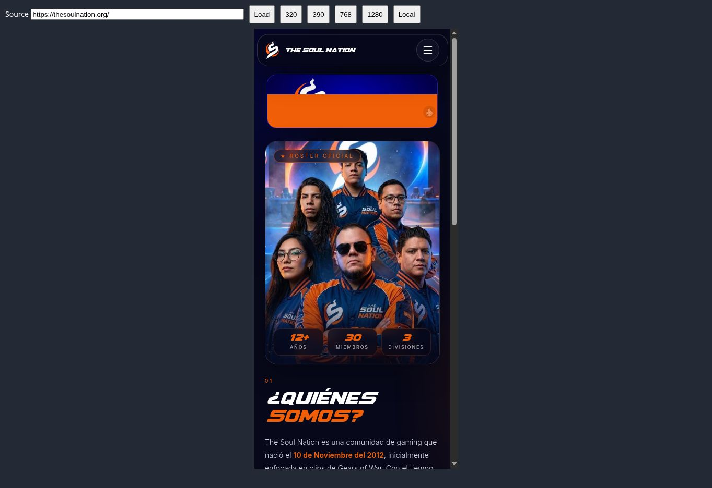 | 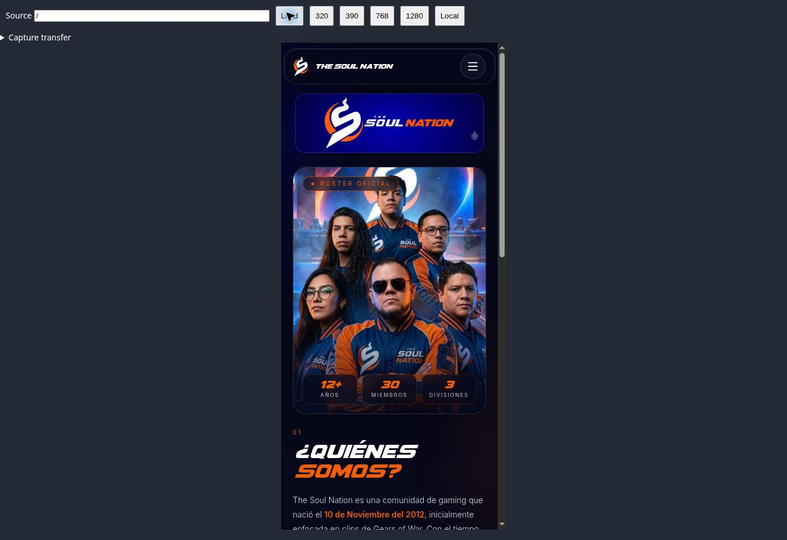 |

### Roster en escritorio

| Antes | Después |
| --- | --- |
| 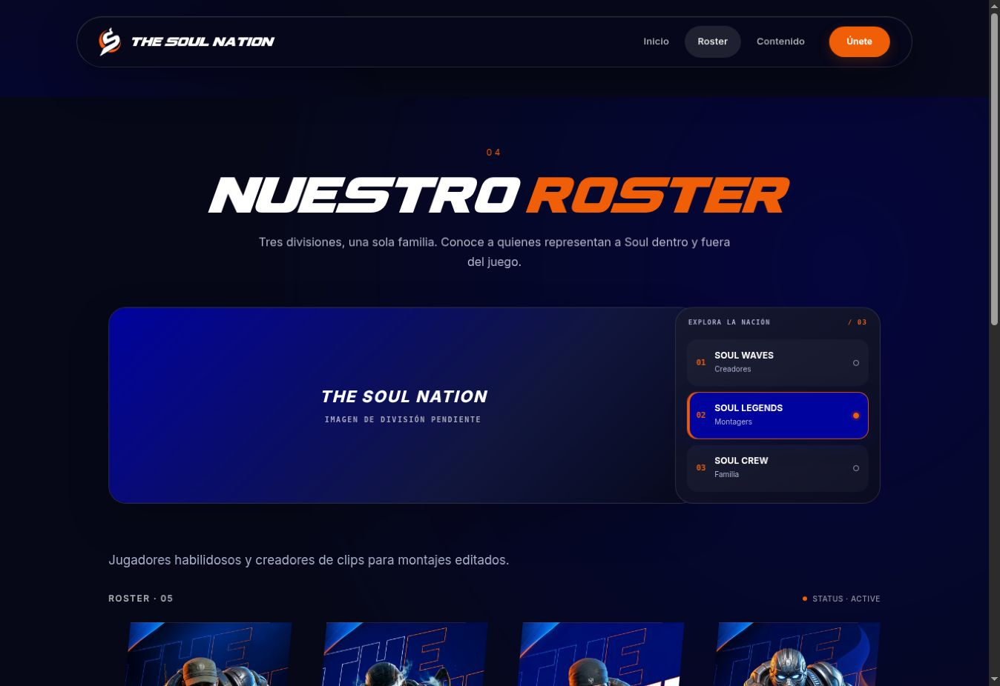 | 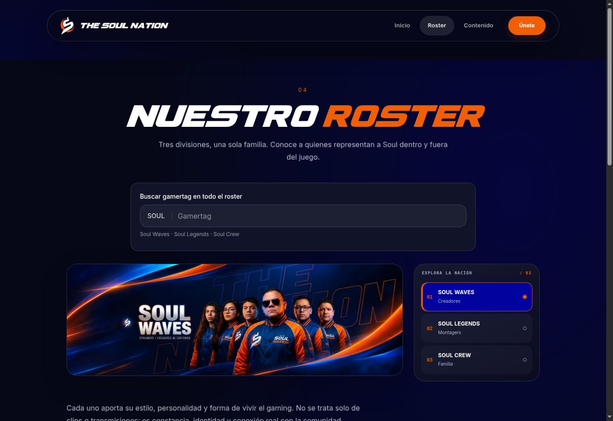 |

### Perfiles

| Antes · 390 px | Después · regresión a 320 px |
| --- | --- |
| 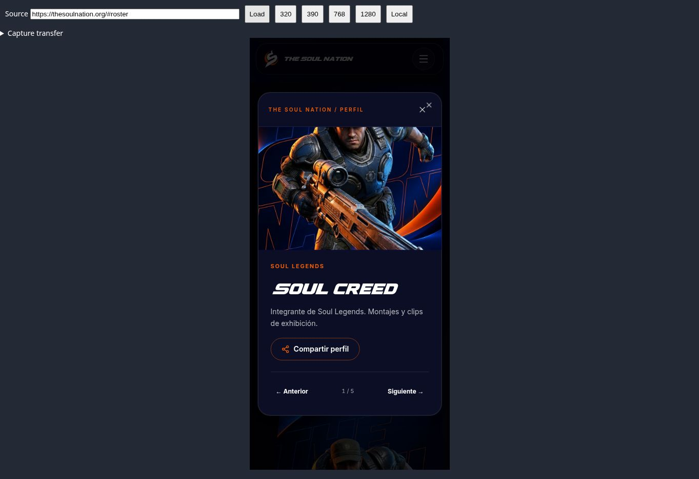 | 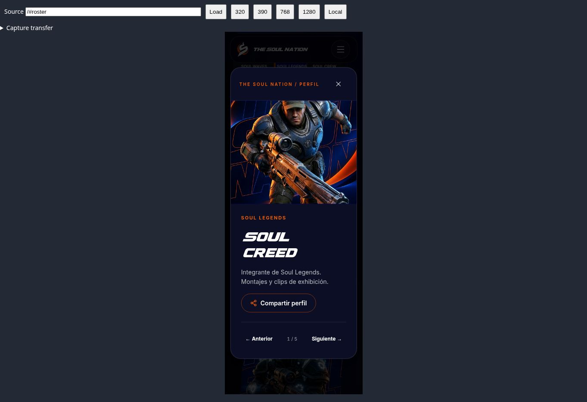 |

### Redes en escritorio

| Antes | Después |
| --- | --- |
| 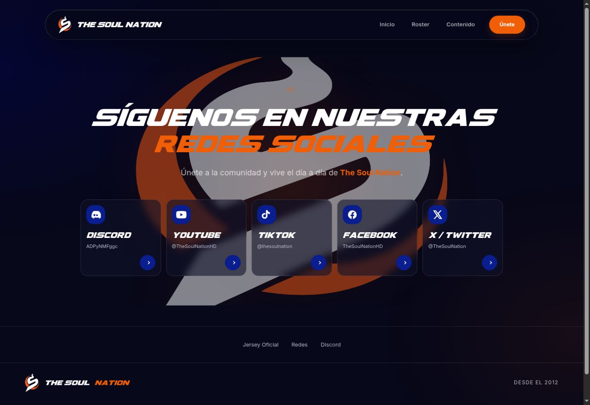 | 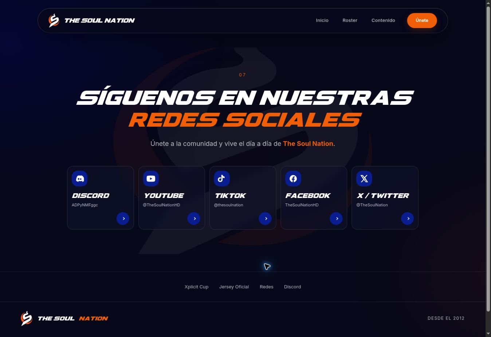 |

### Xplicit Cup móvil · 390 px

| Antes | Después |
| --- | --- |
| 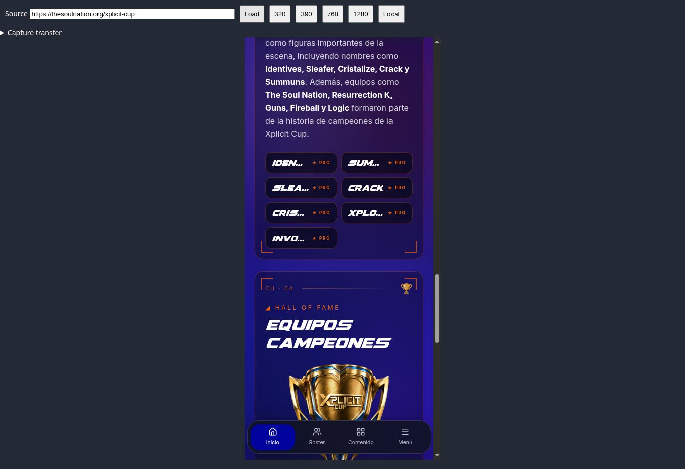 | 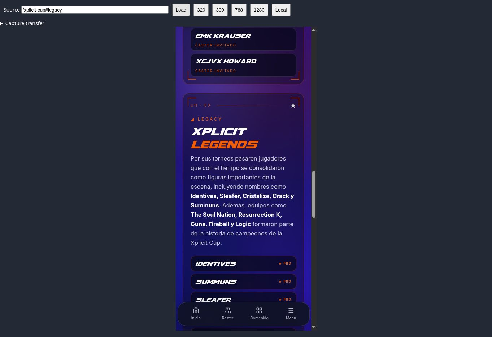 |

## Comprobaciones técnicas

- `npm run build`: correcto, incluida compilación cliente y servidor.
- `git diff --check`: correcto.
- ESLint de los archivos TSX modificados, excluyendo la regla de formato `prettier/prettier`: 0 errores y 3 advertencias de dependencias de hooks ya presentes. El lint con formato habilitado no está limpio; se evitó reformatear archivos completos ajenos al alcance visual.
- `tsc --noEmit`: no está limpio. Se ejecutó también sobre una extracción del commit original `6f59649`, con las mismas dependencias, y se confirmaron los mismos dos errores: el tipo de inserción en `recruitment-form.tsx` y el tipo de `extra_links` en `use-waves-socials.ts`. No se introdujeron nuevos errores de TypeScript.
- En las vistas estrechas medidas (roster, videos, música y Xplicit Cup), el ancho del documento coincidió con su ancho útil. Las comprobaciones visuales adicionales incluyeron 390 y 768 px.
- La preferencia de movimiento reducido se respeta mediante `MotionConfig` y se omite el seguimiento de puntero del jersey cuando está activa. Esto se revisó en código; no se simuló una configuración de accesibilidad del sistema operativo.
- No hay cambios de archivos en `src/assets/`, imágenes oficiales de `public/` ni fuentes. Las nuevas PNG de esta carpeta son exclusivamente evidencia de la auditoría.

## Límites

La revisión móvil es responsive en el navegador de escritorio, no una prueba física en Android o iOS. No se afirma cumplimiento integral de accesibilidad. No se enviaron formularios, mensajes, compras ni datos personales. Los componentes de Spotify siguen siendo externos y pueden abreviar sus textos a anchos pequeños; se conserva el enlace directo al artista. Se verificó el diseño del reproductor, no una escucha completa de todas las pistas. La presencia de banners administrados y de información externa depende de sus fuentes originales.

Las capturas «después» corresponden a la copia local comprobada. Guardar el commit en GitHub no demuestra por sí mismo que el dominio público ya lo esté sirviendo.

## Integración final de la rama

Durante la auditoría la rama remota avanzó desde `6f59649` hasta `818f00d`. Se integraron esos cambios y se conservaron sus mejoras de foco, estados de carga y error del roster, búsqueda, paneles accesibles, estado real de música y diseño de Xplicit Cup. Las capturas 24–51 documentan la primera corrección verificada; las capturas 52–57 documentan la revisión posterior a esa integración. Se comprobaron nuevamente Inicio, roster en escritorio, controles musicales a 320 px, Xplicit Cup en escritorio/celular y etiquetas de Contenido a 320 px. La captura 57 confirma que tanto el título como la pestaña Wallpapers se leen sin partir palabras.

| Roster integrado · escritorio | Música integrada · 320 px |
| --- | --- |
|  | 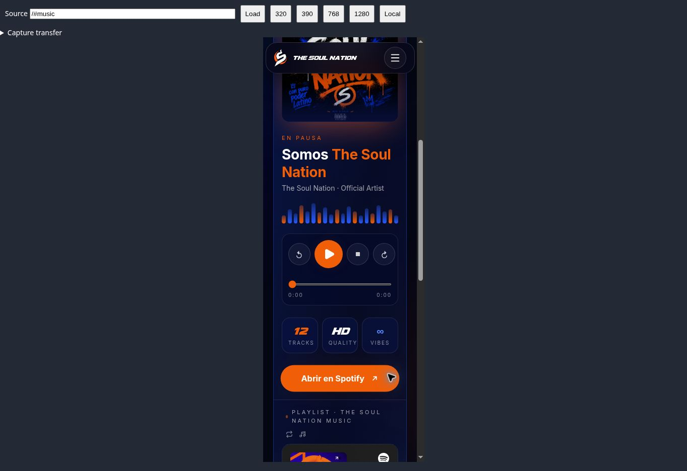 |

## Índice de capturas

Los números reflejan la secuencia de captura. `before` corresponde al sitio público y `after` a la copia corregida. Las imágenes conservan el encuadre original del navegador o banco de revisión.

- [01-home-mobile-before.png](01-home-mobile-before.png)
- [02-legends-desktop-before.png](02-legends-desktop-before.png)
- [03-roster-mobile-before.png](03-roster-mobile-before.png)
- [04-crew-desktop-before.png](04-crew-desktop-before.png)
- [05-legends-mobile-before.png](05-legends-mobile-before.png)
- [06-profile-desktop-before.png](06-profile-desktop-before.png)
- [07-profile-mobile-before.png](07-profile-mobile-before.png)
- [08-redes-desktop-before.png](08-redes-desktop-before.png)
- [09-videos-mobile-before.png](09-videos-mobile-before.png)
- [10-xplicit-entry-desktop-before.png](10-xplicit-entry-desktop-before.png)
- [11-wallpapers-mobile-before.png](11-wallpapers-mobile-before.png)
- [12-xplicit-desktop-before.png](12-xplicit-desktop-before.png)
- [13-music-mobile-before.png](13-music-mobile-before.png)
- [14-xplicit-history-desktop-before.png](14-xplicit-history-desktop-before.png)
- [15-jersey-mobile-before.png](15-jersey-mobile-before.png)
- [16-recruitment-mobile-before.png](16-recruitment-mobile-before.png)
- [17-xplicit-end-desktop-before.png](17-xplicit-end-desktop-before.png)
- [18-form-mobile-before.png](18-form-mobile-before.png)
- [19-redes-mobile-before.png](19-redes-mobile-before.png)
- [20-home-desktop-before.png](20-home-desktop-before.png)
- [21-xplicit-mobile-before.png](21-xplicit-mobile-before.png)
- [22-home-access-desktop-before.png](22-home-access-desktop-before.png)
- [23-xplicit-chapters-mobile-before.png](23-xplicit-chapters-mobile-before.png)
- [24-home-mobile-after.png](24-home-mobile-after.png)
- [25-roster-desktop-after.png](25-roster-desktop-after.png)
- [26-home-access-320-after.png](26-home-access-320-after.png)
- [27-roster-320-after.png](27-roster-320-after.png)
- [28-legends-desktop-after.png](28-legends-desktop-after.png)
- [29-profile-320-after.png](29-profile-320-after.png)
- [30-profile-desktop-after.png](30-profile-desktop-after.png)
- [31-videos-320-after.png](31-videos-320-after.png)
- [32-videos-desktop-after.png](32-videos-desktop-after.png)
- [33-wallpapers-320-after.png](33-wallpapers-320-after.png)
- [34-wallpapers-desktop-after.png](34-wallpapers-desktop-after.png)
- [35-music-320-after.png](35-music-320-after.png)
- [36-jersey-320-after.png](36-jersey-320-after.png)
- [37-music-desktop-after.png](37-music-desktop-after.png)
- [38-jersey-desktop-after.png](38-jersey-desktop-after.png)
- [39-recruitment-desktop-after.png](39-recruitment-desktop-after.png)
- [40-music-controls-320-after.png](40-music-controls-320-after.png)
- [41-redes-desktop-after.png](41-redes-desktop-after.png)
- [42-xplicit-desktop-after.png](42-xplicit-desktop-after.png)
- [43-xplicit-320-after.png](43-xplicit-320-after.png)
- [44-xplicit-chapters-desktop-after.png](44-xplicit-chapters-desktop-after.png)
- [45-xplicit-chapters-320-after.png](45-xplicit-chapters-320-after.png)
- [46-roster-tablet-after.png](46-roster-tablet-after.png)
- [47-xplicit-header-mobile-after.png](47-xplicit-header-mobile-after.png)
- [48-xplicit-names-mobile-after.png](48-xplicit-names-mobile-after.png)
- [49-waves-profile-desktop-after.png](49-waves-profile-desktop-after.png)
- [50-xplicit-tablet-end-after.png](50-xplicit-tablet-end-after.png)
- [51-xplicit-legends-390-after.png](51-xplicit-legends-390-after.png)
- [52-merged-home-390.png](52-merged-home-390.png)
- [53-merged-roster-desktop.png](53-merged-roster-desktop.png)
- [54-merged-music-controls-320.png](54-merged-music-controls-320.png)
- [55-merged-xplicit-mobile.png](55-merged-xplicit-mobile.png)
- [56-merged-xplicit-desktop.png](56-merged-xplicit-desktop.png)
- [57-merged-wallpapers-320.png](57-merged-wallpapers-320.png)
